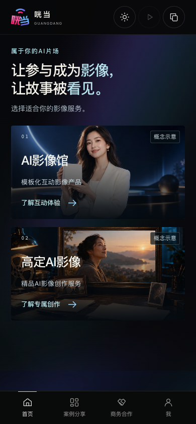

# 06｜深浅色行为与UI实现约束

2026-11-01发布版本：`scene-plans-20261101`。用户已授权发布到原仓库，提交与线上验证见[发布回执](release-scene-plans-20261101.md)。保留冷蓝/紫色与深浅色切换；八案图解与折叠阅读以[10](10-mobile-scene-plans-20261101.md)优先，[09](09-apple-story-and-interactions-20261101.md)保留官网式图文和来源规则。本页切换、状态及可访问性约束继续适用，真实服务边界不因视觉改版改变。

本轮验证以[2026-11-01回执](verification-scene-plans-20261101.md)为准；[10月30日回执](verification-local-20261030.md)及下方20261029-light-dark的152项检查是历史证据，不证明新方案/导航已通过。发布状态另见[发布回执](release-scene-plans-20261101.md)。

## 用户行为

- 默认深色。顶部太阳/月亮按钮切换到另一种外观；切换后图标与提示同步变化。
- 同一浏览页面跨路由保留外观选择；刷新后回默认深色。不写localStorage/sessionStorage，不在分享链接中携带外观或草稿。
- 切换只更新根外观标记，不重挂页面。表单值、主题选择、当前步骤、本机照片、照片授权、滚动位置和键盘焦点保持。
- 原生模态弹窗打开时背景控件不可操作；关闭后可切换外观。两种外观的弹窗、手动复制、遮罩与失败状态均需可读。

按钮为44px可点击控件，固定可访问名称“亮色模式”，`aria-pressed=true`表示亮色；title提示目标外观。正文、原生控件、导航、图文、表单、访客页和空态一并适配。照片不反相；图片内短文案继续用浅字与深色保护层，图下正文使用当前主题的正常文字颜色。

## 前端实现点

| 文件 | 职责 |
|---|---|
| `app/Guangdang.tsx` | 根`colorMode: 'dark' or 'light'`状态；独立useLayoutEffect更新`html[data-theme]`；不改变main/page的key与路由 |
| `app/color-themes.css` | 亮色语义配色基线，覆盖文字、表面、控件、选中/禁用、弹窗、空态与图片叠字；本轮后置样式必须同时适配 |
| `app/ui-polish.css` | 两版共用的短屏几何、说明标签和图片自然比例，不处理业务状态 |
| `app/mobile-editorial-data.ts` | `imageFormat?: 'portrait'`仅标记参考图片自然比例，不是后端参数或约定成片画幅 |
| `app/guangdang.css`、`app/cyber.css` | 旧按钮hover限定精细指针，避免触屏点击后残留旧背景 |
| `app/b2b-refinement.css` | 上一轮方案专页/索引和四导航的深浅色基础 |
| `app/apple-editorial.css` | 官网式留白、图文叙事和控件基础，深浅两版同步 |
| `app/scenario-plans.css` / `app/brand-mobile-story.css` | 最终手机方案样式层：三节点图解、选择反馈、短句层级、双端成果与折叠内容 |
| `tests/color-themes.mjs` | 深浅色回归脚本已同步新版DOM/图解/折叠断言；实际是否执行以对应回执为准 |

样式顺序：基础样式 → `mobile-editorial.css` → `ui-polish.css` → `color-themes.css` → `product-experience.css` → `experience-center.css` → `consultation-pages.css` → `b2b-refinement.css` → `apple-editorial.css` → `scenario-plans.css` → `brand-mobile-story.css`，以 `main.tsx` 为准。不要用整站filter反相、替换路由、给页面增加主题key或重新初始化草稿来实现切换。

## 2026-10-29历史UI修复及后续复验

| 原编号 | 调整与核验 |
|---|---|
| R04 | 选项/创作说明前置；静态选项改轻文字标签，与可点击设置按钮区分，未新增伪配置 |
| R08 | 活动参考竖图按自然2:3、最大240px呈现，实际图像占画框约99.94%，不再塞入横框产生大块空边；此比例不约定交付视频画幅 |
| R09 | 320×568短屏产品主视觉270px，四锚点425–481px，位于底栏502px上方；大屏不套此规则 |
| R10 | 两层旧hover均限定精细指针；深浅两版真触点复制后配色稳定，复制反馈保留 |

旧R01/R05/R06保护已在10月30日修订；本轮R02按B端主动作重定义，R03/R07有长页导航与内容精简调整，其本地自检结果与范围见最新回执，详见[04](04-acceptance-and-issues.md)。业务缺口更新为B01–B13；B12按需求报价已确认，待定的是每项目金额与范围。

## 历史测试与本轮检查边界

`color-themes.mjs`覆盖表面和状态保护，新版导航、图解及折叠断言已同步并完成语法检查；是否执行整套浏览器测试及结果单列回执。本轮本地由CUA检查深浅色、选择反馈、锚点、长中文和折叠展开，不沿用历史通过数。

以下是2026-10-29深浅色版的历史结果：

新增主题检查152/152通过：4档宽度×18页面×深浅两版共144项表面，加8项状态/交互。包含节点与表单/照片授权/步骤/滚动保留、键盘焦点、跨路由、弹窗、真触点、刷新回默认及零存储；无脚本错误、意外资源失败或上传/接口请求。模拟图片失败另作为预期降级用例记录。最终回归与发布结果见[本版验证](verification-light-dark-20261029.md)。真机及用户验收单独记录。

